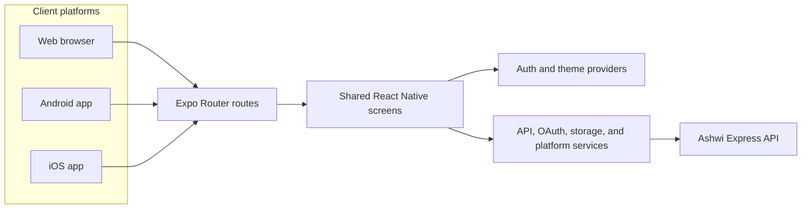
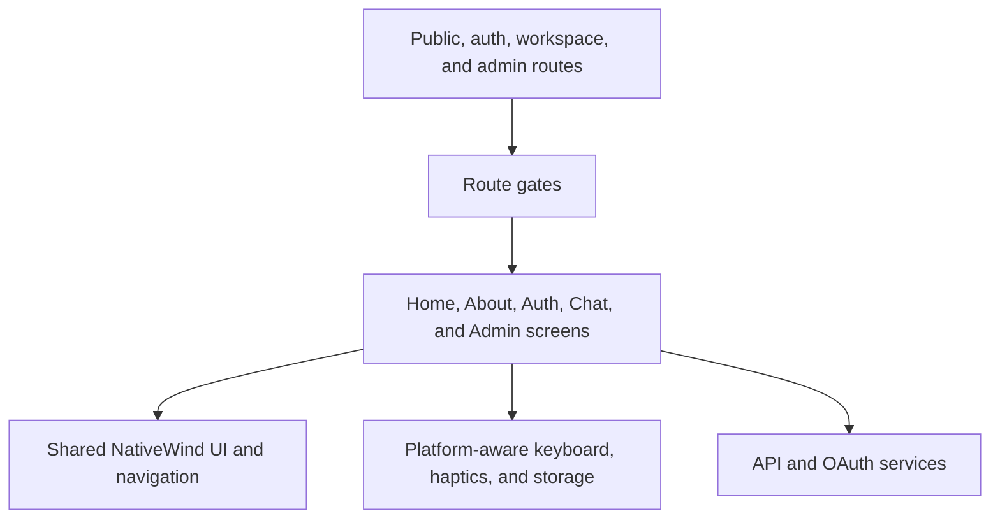

# Ashwi frontend

Ashwi is a shared React Native application for web, Android, and iOS. Expo Router provides navigation, NativeWind styles the shared screens, and the app calls the Ashwi REST API for accounts, AI chat, conversation history, and administration.

## Architecture





## Features

- Marketing home page and About page with product, technology, and creator information
- Email sign-up, sign-in, password reset, email verification, and Google/GitHub OAuth
- Profession-aware AI chat, saved conversations, and profile settings
- Admin overview, user management, chat monitoring, and system logs
- Responsive desktop, tablet, and phone layouts with NativeWind and shared components
- Web SEO metadata and structured product data on public pages

## Run locally

Install dependencies from this directory and configure the API URL:

```powershell
pnpm install
Copy-Item .env.example .env
pnpm web --port 3000
```

The frontend expects the backend API on port `5000`. `.env.example` points web and iOS to localhost; Android emulators use `10.0.2.2`, and physical devices need the computer's LAN address. Set `EXPO_PUBLIC_API_BASE_URL` in `.env` when the API is not reachable at the default host.

Run the backend separately using its `.env.example` and start command. Google and GitHub sign-in also require provider credentials and registered callback URLs in the backend environment.

## Platform commands

```powershell
pnpm web --port 3000
pnpm typecheck
pnpm test
pnpm test:responsive
pnpm export:web
pnpm android
```

Native Android builds require Android Studio and the Android SDK. iOS builds require macOS and Xcode. Responsive browser checks require a running web preview and installed Chrome.

## SEO deployment setting

Set `EXPO_PUBLIC_SITE_URL` to the deployed HTTPS origin before running `pnpm export:web`. Static export then writes canonical and social metadata into rendered pages and generates `robots.txt` and `sitemap.xml` for that origin.

## Vercel deployment

The root `vercel.json` builds this Expo Router app as a static site and publishes `dist/web`. Keep the Vercel project root set to the repository root. Add `EXPO_PUBLIC_API_BASE_URL` and `EXPO_PUBLIC_SITE_URL` as build environment variables in the Vercel project. Assign the intended `*.vercel.app` hostname under **Project Settings → Domains**; a repository push cannot register or attach a Vercel domain.
